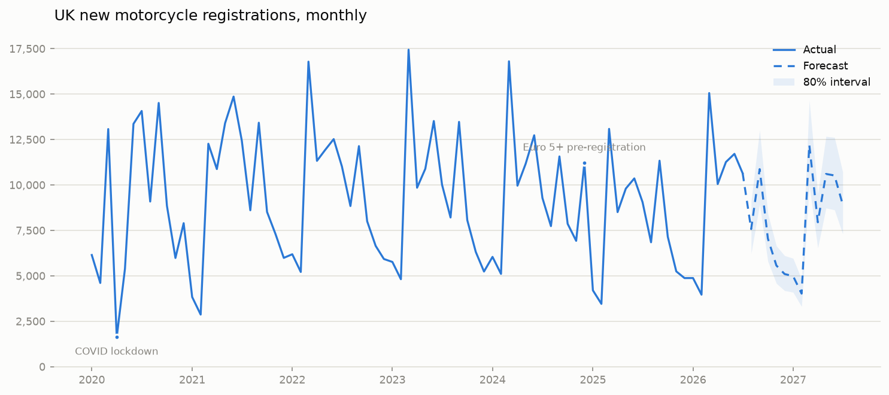

# Motorcycle sales forecast

Monthly forecast of UK new motorcycle registrations, built from public
data: MCIA press statistics (scraped from ~80 monthly PDFs) and Met
Office UK climate series.



## Forecast vs actual

The forecast was fixed at publication and is never revised. As MCIA publishes
each new month, `scripts/10_forecast_vs_actual.py` scores it against the
actual; the running table is `outputs/forecast_vs_actual.csv`.

Three months in (Aug - Oct 2026): MAPE 8.8% against the backtest's promised
10.3%, all three actuals inside the 80% interval, and OLS ahead of the
SARIMAX benchmark in every month so far. One honest wrinkle: all three errors
sit the same side, with each month under-forecast. Three readings is too few
to call that bias, so it is noted here rather than corrected.

## Headline results

- **79-month series, Jan 2020 – Jul 2026, zero gaps.** Each MCIA PDF also
  reports the same month a year earlier, which both cross-validates the
  series (one ±1 revision in 65 checks) and backfills the two months
  whose PDFs were never published.
- **Next 12 months (Aug 2026 – Jul 2027): ~95,400 registrations**, with
  warm/cool-summer scenarios spanning 93.8k–97.0k.
- **Backtest (rolling one-step-ahead, last 18 months):** seasonal naive
  23.0% MAPE, SARIMAX 14.6%, **OLS 10.3%** — the simple regression wins.
- **Weather barely matters.** Contemporaneous temperature, sunshine and
  rainfall anomalies are all insignificant once seasonality and events
  are controlled. The one survivor: **last month's temperature anomaly
  during riding season** (+1 °C ≈ +4% registrations next month, p≈0.07)
  — consistent with warm weather driving purchases that register a month
  later.

## Model

`log(registrations) ~ trend + month dummies + lagged in-season
temperature anomaly + event dummies`, where the events are the COVID
lockdowns (Apr–May 2020, Jan–Feb 2021) and the Euro 5+ cliff-edge
(pre-registration spike Dec 2024, payback Jan–Feb 2025). A SARIMAX
variant with the same regressors is fitted for comparison; forecast
intervals on the headline numbers are 80%.

Future months use climatological weather (anomaly = 0); the first
forecast step uses the previous month's *observed* anomaly, which is
already known.

## Pipeline

| Script | Does |
|---|---|
| `scripts/01_scrape_mcia.py` | crawl MCIA downloads, save monthly press-statistics PDFs |
| `scripts/02_parse_pdfs.py` | parse PDFs → monthly series, cross-validate, backfill gaps |
| `scripts/03_weather.py` | fetch Met Office UK series, compute 1991–2020 normals and anomalies |
| `scripts/04_model.py` | fit baseline / OLS / SARIMAX, backtest, write `outputs/forecast.csv` |
| `scripts/05_weather_tests.py` | the weather specification tests behind the model's one weather term |
| `scripts/06_chart.py` | render the headline chart |
| `scripts/07_parse_segments.py` | parse style / capacity-band / brand splits (2023+ PDFs) |
| `scripts/08_segment_forecast.py` | share-of-market forecasts by style, engine-size group and brand |
| `scripts/09_combined_output.py` | one tidy CSV: history + forecast across all dimensions |

```
python3 -m venv .venv && .venv/bin/pip install -r requirements.txt
for s in scripts/0*.py; do .venv/bin/python "$s"; done
```

## Segment splits

The aggregate forecast is split three ways (`outputs/forecast_by_*.csv`)
using a top-down share model: each segment's share of the market is
regressed on trend + month dummies over the 42 months of segment data
(the current MCIA taxonomy starts Jan 2023), then renormalised and
multiplied through the aggregate forecast so splits always add back up.

- **Style** — Adventure, Naked, Scooter, etc. (plus Moped/Tricycle).
- **Engine size** — groups over MCIA's ICE bands, configurable in
  `SIZE_GROUPS` in `scripts/08_segment_forecast.py`; boundaries must
  fall on MCIA band edges (50/125/500/750/1000cc). Electric is reported
  by kW, not cc, so it forms its own group.
- **Brand** — MCIA publishes a top-10-only table, so brands outside it
  in a month are censored, not zero. Brands present in ≥90% of months
  become named series; the rest fold into "Other" (~a third of the
  market).

## Sources

- [MCIA press statistics](https://mcia.co.uk/press-statistics) — new road
  registrations by vehicle type. Raw PDFs are © MCIA and not
  redistributed here; the scraper rebuilds `data/raw_pdfs/`.
- [Met Office HadUK-Grid areal series](https://www.metoffice.gov.uk/research/climate/maps-and-data/uk-and-regional-series)
  — UK monthly mean temperature, sunshine, rainfall.

## Known limits

- 79 observations is short for seasonal estimation; the March/September
  plate-month spikes lean on six observations each.
- The 2025 market fall (−19%) is only partly explained by the Euro 5+
  dummies; the trend term absorbs the rest, so the forecast assumes the
  2026 recovery pace persists.
- Aggregate market only. Style/capacity splits exist in the PDFs and are
  the natural v2 (model launches and decommissions start to matter
  there).

## Data note

The raw MCIA press PDFs are not committed: they are MCIA's documents to
distribute, and `scripts/01_scrape_mcia.py` fetches them from the source in
minutes. What is committed is the derived monthly series and segment
aggregates, with attribution above. If MCIA ever objects to those, they come
down too.
